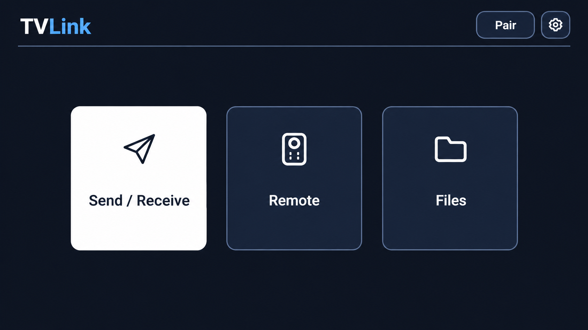
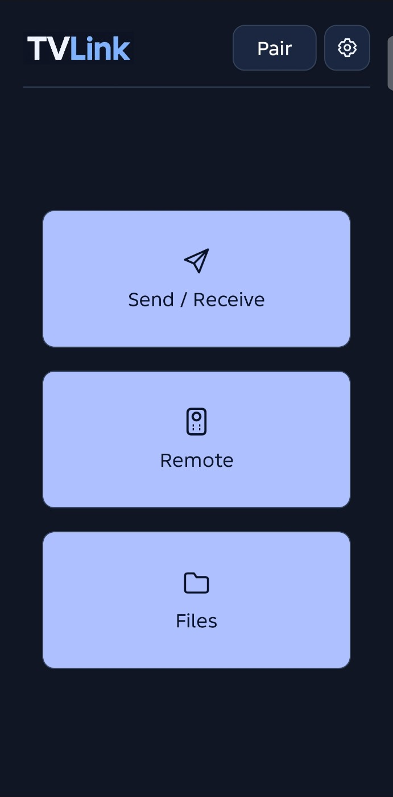

  

  An Android TV remote, keyboard and file transfer app for your phone and TV over the same Wi-Fi network.

  <a href="https://github.com/nudroid12/TVLink/releases/latest"><strong>Download APK</strong></a>

## Screenshots

| Android TV Home (recreated preview) | Mobile Home |
| :---: | :---: |
|  |  |

## Features

- **Remote control** — navigate Android TV from your phone.
- **Android TV keyboard** — use your phone’s keyboard to type in supported text fields on your TV.
- **Two-way file transfer** — send files between your phone and TV.
- **My Files** — browse received files and move them between folders on your TV.

## Quick start

1. Install the **Universal APK** on your phone and Android TV and connect both to the same Wi-Fi network.
2. Open **Pair** on the TV. On your phone, select **Pair → Find TV** and enter the code shown on the TV. Approve file transfer if prompted.
3. Open **Remote** or **Send / Receive** from Home. Keep TVLink open on the receiving device during a transfer.

[Report an issue](https://github.com/nudroid12/TVLink/issues) · Developed by **NudroidLabs**
